> 2023.9.2
>
> 王特起
>

# Ubuntu系统设置

## 虚拟机中安装Ubuntu

### 版本

- macOS 12.7.4
- VMware Fusion 13.5.2
- Ubuntu 22.04.5 server amd64

### 安装步骤

> [!Important]
>
> 参考[VMware-download-helper](https://github.com/St7530/VMware-download-helper)，解决下载VMware出现"Account verification is Pending. Please try after some time."的问题

1. 下载VMware

2. 下载Ubuntu镜像[ubuntu 22.04.5 server amd64](https://releases.ubuntu.com/22.04/?_gl=1*1jvf8rd*_gcl_au*MTExNTY0Nzk5OC4xNzgxNjExOTky)

3. 在VMware Fusion中配置虚拟机

    - 设置虚拟机名称为 `Ubuntu22045.vmwarevm`

    - 停用侧通道缓解

    - 设置硬盘大小为200G，同时在 ==Ubuntu终端== 中进行配置

        ```bash
        # 查看当前磁盘、分区、LVM 和挂载情况
        lsblk
        # 扩展磁盘空间
        sudo pvresize /dev/sda3
        sudo lvextend -r -l +100%FREE /dev/mapper/ubuntu--vg-ubuntu--lv
        # 查看根目录 / 的实际可用容量
        df -h /
        ```

    - 若设置USB为3.1，需同时打开 ==Mac终端== 修改VMware Fusion 的 preferences 配置文件

        ```zsh
        grep -q 'vusbcamera.passthrough' ~/Library/Preferences/VMware\ Fusion/preferences || echo 'vusbcamera.passthrough = "TRUE"' >> ~/Library/Preferences/VMware\ Fusion/preferences
        ```

4. 在虚拟机中安装ubuntu 22.04.5

    - 安装完成后使用 `uname -a` 查看

    - 安装net-tools，这样就可以在 ==mac终端== 下使用ssh连接到虚拟机

        ```bash
        # 更新软件源列表
        sudo apt update
        # 安装你需要的软件net-tools
        sudo apt install net-tools
        # 查看端口
        ifconfig
        ```

    - 安装桌面版

        ```bash
        # 更新软件源列表，并升级当前系统中已经安装的软件包
        sudo apt update && sudo apt upgrade -y
        # 安装 Ubuntu 图形桌面环境
        sudo apt install ubuntu-desktop -y
        # 设置系统默认启动到图形界面
        sudo systemctl set-default graphical.target
        # 重启虚拟机，让桌面环境和启动设置生效
        sudo reboot
        ```

    - 安装VMware Tools

        ```bash
        # 更新软件源
        sudo apt update
        # 安装你需要的软件VMware Tools
        sudo apt install open-vm-tools open-vm-tools-desktop -y
        # 重启虚拟机
        sudo reboot
        ```

## 双系统中安装Ubuntu

### 版本

- Win11
- Ubuntu 24.04.4 desktop amd64
- Ubuntu 22.04.5 desktop amd64

### 安装步骤

1. 使用Rufus制作系统盘，`引导类型选择`找到 ==镜像文件==，`分区类型` 选择 ==GPT==

    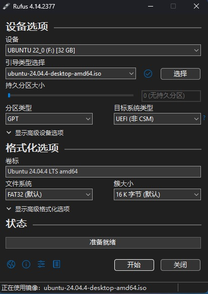

2. 划分磁盘

    右击我的电脑，找到 `属性-->管理-->磁盘管理`，在D盘点击 ==压缩卷==，然后输入压缩空间量为300G(307200MB)

    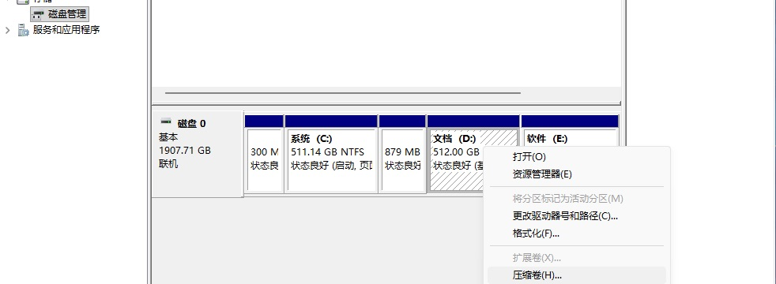

    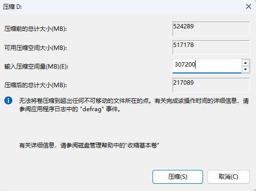

3. 重启后按 <kbd>F2</kbd> 进入BIOS，关闭 `Secure boot`，并调整启动顺序为 `UEFI`，按 <kbd>F10</kbd> 保存

    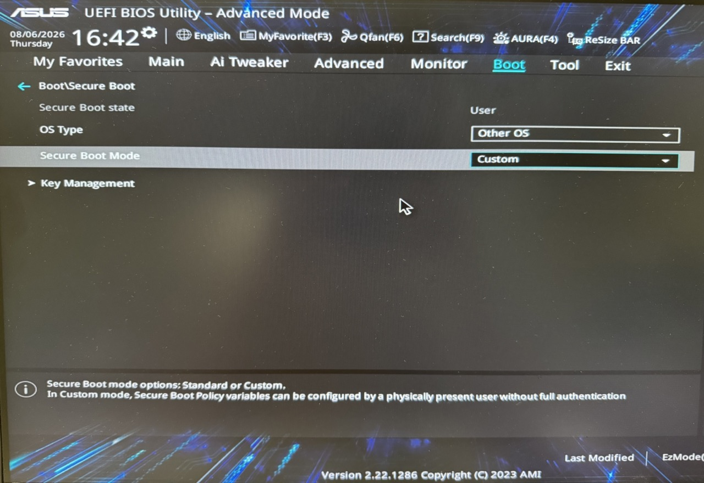

    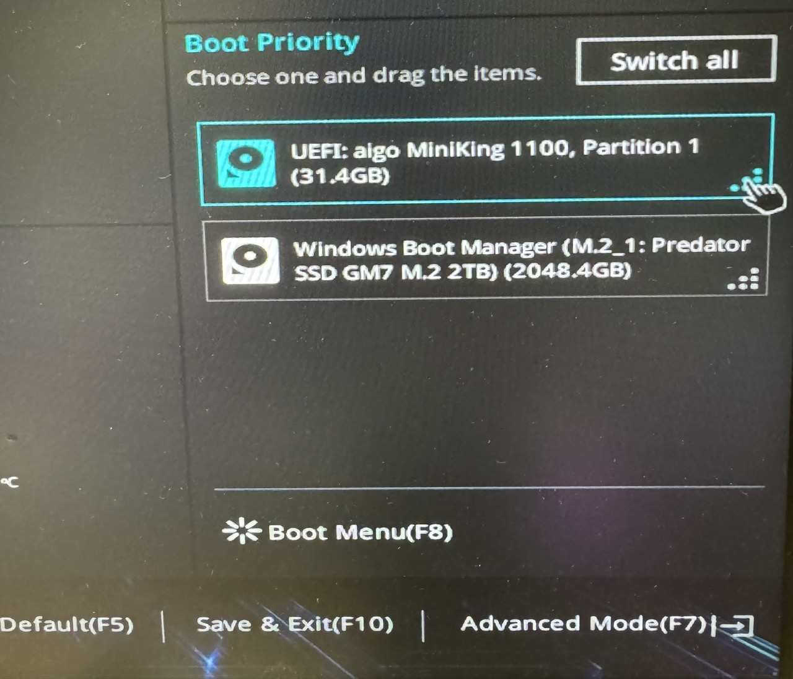

4. 关闭独显直连

    在GRUB启动界面的 `Try or install Ubuntu` 这一项上按 <kbd>E</kbd> 键编辑启动项参数，找到 `linux开头` 的这一行，在后面添加 ==nomodeset== 参数，按 <kbd>F10</kbd> 保存

    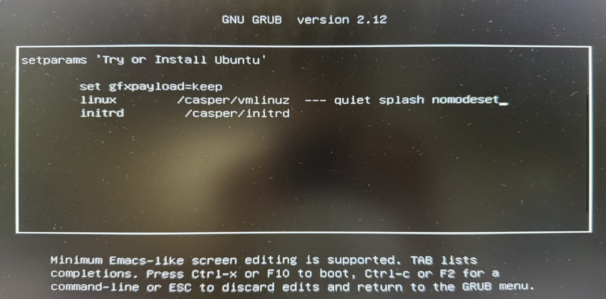

5. 安装显卡驱动，这两项勾上

    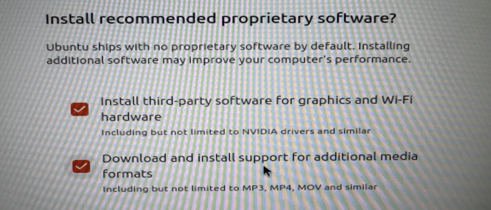

6. 选择 `Manual installation` 自定义磁盘分区

    - /boot：

        大小：2G；文件类型：ext4

    - swap：

        大小：16G；文件类型：swap

    - /：

        大小：100G；文件类型：ext4

    - /home：

        大小：剩余空间；文件类型：ext4

    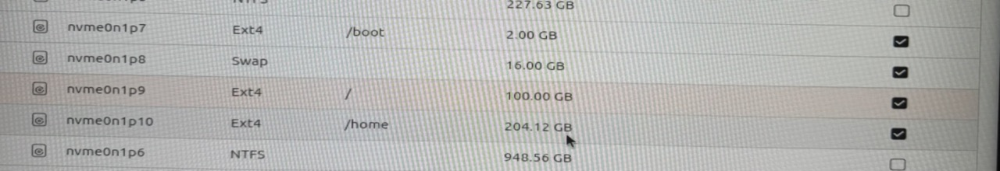

> [!Note]
>
> 22.04.5版本选择 `Something else` 自定义磁盘分区需要设置efi
>
> 大小：500MB；文件类型：EFI
>
> 引导器的设备选择 ==刚才分配的efi系统分区==
>
> - efi：500MB
> - swap：16G
> - /：100G
> - /home：剩余空间
> - 引导器的设备选择 ==刚才分配的efi系统分区== 

### 重装步骤

1. 使用DiskGenius软件删除Ubuntu的esp分区，swap分区，/分区和/home分区（即图中的(5)，(6)，(7)和(8)分区），记得 ==保存更改==

    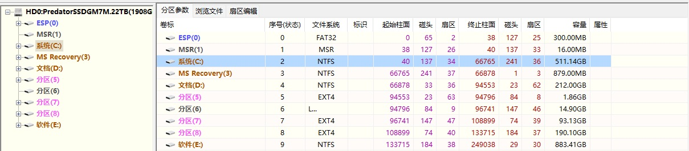

2. 在 `ESP(0)-->EFI` 中彻底删除整个 `ubuntu文件夹`（点击 ==彻底删除文件==），这用于删除Ubuntu引导项

    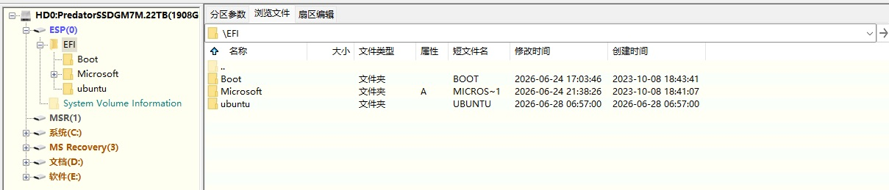

3. 右击我的电脑，找到 `属性-->管理-->磁盘管理`，在D盘点击 ==扩展卷==

    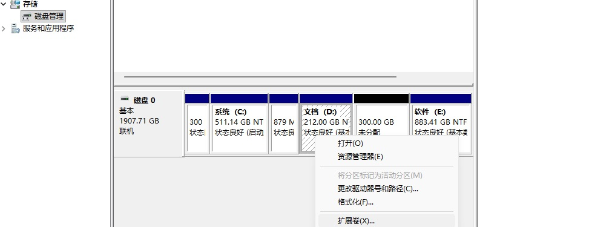

## 软件设置

### Zsh安装

使用apt安装

```bash
# 更新软件源列表
sudo apt update
# 安装zsh
sudo apt install zsh
# 将 Zsh 设置为当前用户的默认登录 Shell
chsh -s "$(command -v zsh)"
# 注销并重新登录后，查看默认登录 Shell
echo $SHELL
```

### Clash Verge安装

使用deb包安装

```zsh
sudo apt install ~/Downloads/Clash.Verge_2.5.2_amd64.deb
sudo apt install ~/Downloads/Clash.Verge_2.5.2_arm64.deb
```

### Typora安装

使用deb包安装

```zsh
sudo apt install ~/Downloads/typora_1.14.9_amd64.deb
```

### Google Chrome安装

使用deb包安装

```zsh
sudo apt install ~/Downloads/google-chrome-stable_current_amd64.deb
sudo apt install ~/Downloads/google-chrome-stable_current_arm64.deb
```

### Git/Curl/openssh-server安装

使用apt安装

```zsh
sudo apt install git
sudo apt install curl
sudo apt install openssh-server
```

### Zinit安装

1. 通过配置 `.zshrc` 文件进行安装，并设置基础功能

    ```zsh
    # --------------- Zinit ---------------
    ZINIT_HOME="${XDG_DATA_HOME:-${HOME}/.local/share}/zinit/zinit.git"
    
    if [[ ! -d "$ZINIT_HOME" ]]; then
        mkdir -p "${ZINIT_HOME:h}"
        git clone https://github.com/zdharma-continuum/zinit.git "$ZINIT_HOME"
    fi
    
    source "$ZINIT_HOME/zinit.zsh"
    
    # --------------- Options ---------------
    setopt numeric_glob_sort
    
    # --------------- Keybindings ---------------
    bindkey -e
    
    # --------------- Completion / Plugins ---------------
    zinit light zsh-users/zsh-completions
    zinit snippet OMZP::git
    
    zstyle ':completion:*' menu select
    zstyle ':completion:*' matcher-list 'm:{a-zA-Z}={A-Za-z}'
    
    autoload -Uz compinit
    compinit
    zinit cdreplay -q
    
    # --------------- Autosuggestions ---------------
    zinit light zsh-users/zsh-autosuggestions
    
    # --------------- History ---------------
    HISTFILE="$HOME/.zsh_history"
    HISTSIZE=10000
    SAVEHIST=10000
    
    setopt share_history
    setopt hist_ignore_space
    setopt hist_ignore_all_dups
    setopt hist_find_no_dups
    
    # --------------- Syntax highlighting ---------------
    zinit light zsh-users/zsh-syntax-highlighting
    
    ```

2. 配置现代命令行工具 `eza`，`bat`

    - 使用apt安装

        ```zsh
        # 24.04.4
        sudo apt install eza 
        sudo apt install bat
        
        # 22.04.5没有eza
        sudo apt install bat
        ```
    
    - 在 `.zshrc` 文件中添加现代命令行工具
    
        ```zsh
        # 24.04.4
        # --------------- Aliases ---------------
        alias ls='eza --icons --group-directories-first'
        alias ll='eza -l --icons --sort=name'
        alias lt='eza --tree --icons --level=2 --group-directories-first'
        alias cat='batcat --paging=never --style=plain'
        
        # 22.04.5
        # --------------- Aliases ---------------
        alias cat='batcat --paging=never --style=plain'
        ```

### Ghostty安装

1. 使用脚本安装

    ```zsh
    # 24.04.04
    /bin/bash -c "$(curl -fsSL https://raw.githubusercontent.com/mkasberg/ghostty-ubuntu/HEAD/install.sh)"
    
    # 22.04.5
    sudo snap install ghostty --classic
    ```

2. 配置Ghostty

    ```zsh
    # ============================================
    # Ghostty Terminal Configuration (Ubuntu)
    # File: ~/.config/ghostty/config.ghostty
    # Reload: Ctrl + Shift + ,
    # ============================================
    
    # --- 字体 ---
    font-family = "Maple Mono NF CN"
    font-size = 14
    adjust-cell-height = 2
    
    # --- 主题 ---
    theme = Catppuccin Mocha
    window-theme = dark
    
    # --- 窗口外观 ---
    background-opacity = 0.85
    window-padding-x = 10
    window-padding-y = 8
    
    # --- 光标 ---
    cursor-style = bar
    cursor-style-blink = true
    cursor-opacity = 0.8
    
    # --- 鼠标与剪贴板 ---
    mouse-hide-while-typing = true
    copy-on-select = clipboard
    clipboard-paste-protection = true
    
    # --- 历史输出缓冲区，约 25 MB ---
    scrollback-limit = 25000000
    
    # ============================================
    # 快捷键
    # ============================================
    
    # --- 标签页 ---
    keybind = ctrl+shift+t=new_tab
    keybind = ctrl+shift+w=close_surface
    
    # --- 创建分屏 ---
    keybind = ctrl+shift+r=new_split:right
    keybind = ctrl+shift+d=new_split:down
    
    # --- 分屏管理 ---
    keybind = ctrl+shift+e=equalize_splits
    keybind = ctrl+shift+f=toggle_split_zoom
    
    # --- 调整字号 ---
    keybind = ctrl+plus=increase_font_size:1
    keybind = ctrl+minus=decrease_font_size:1
    keybind = ctrl+zero=reset_font_size
    
    # --- 重新加载配置 ---
    keybind = ctrl+shift+comma=reload_config
    
    ```

3. 主题配置

    - 使用脚本安装Starship

        ```zsh
        curl -sS https://starship.rs/install.sh | sh
        ```

    - 配置Starship主题为Catppuccin Powerline

        ```zsh
        starship preset catppuccin-powerline -o ~/.config/starship.toml
        ```

    - Catppuccin Powerline样式文件

        ```toml
        # ============================================
        # File: ~/.config/starship.toml
        # ============================================
        "$schema" = 'https://starship.rs/config-schema.json'
        
        add_newline = false
        
        format = """
        [](red)\
        $os\
        $username\
        [](bg:peach fg:red)\
        $directory\
        [](bg:yellow fg:peach)\
        $git_branch\
        $git_status\
        [](fg:yellow bg:green)\
        $c\
        $rust\
        $golang\
        $nodejs\
        $bun\
        $php\
        $java\
        $kotlin\
        $haskell\
        $python\
        [](fg:green bg:sapphire)\
        $conda\
        [](fg:sapphire bg:lavender)\
        $time\
        [ ](fg:lavender)\
        $cmd_duration\
        $line_break\
        $character"""
        
        palette = 'catppuccin_mocha'
        
        [os]
        disabled = false
        style = "bg:red fg:crust"
        
        [os.symbols]
        Windows = ""
        Ubuntu = "󰕈"
        SUSE = ""
        Raspbian = "󰐿"
        Mint = "󰣭"
        Macos = "󰀵"
        Manjaro = ""
        Linux = "󰌽"
        Gentoo = "󰣨"
        Fedora = "󰣛"
        Alpine = ""
        Amazon = ""
        Android = ""
        AOSC = ""
        Arch = "󰣇"
        Artix = "󰣇"
        CentOS = ""
        Debian = "󰣚"
        Redhat = "󱄛"
        RedHatEnterprise = "󱄛"
        
        [username]
        show_always = true
        style_user = "bg:red fg:crust"
        style_root = "bg:red fg:crust"
        format = '[ $user]($style)'
        
        [directory]
        style = "bg:peach fg:crust"
        format = "[ $path ]($style)"
        truncation_length = 3
        truncation_symbol = "…/"
        
        [directory.substitutions]
        "Documents" = "󰈙 "
        "Downloads" = " "
        "Music" = "󰝚 "
        "Pictures" = " "
        "Developer" = "󰲋 "
        
        [git_branch]
        symbol = ""
        style = "bg:yellow"
        format = '[[ $symbol $branch ](fg:crust bg:yellow)]($style)'
        
        [git_status]
        style = "bg:yellow"
        format = '[[($all_status$ahead_behind )](fg:crust bg:yellow)]($style)'
        
        [nodejs]
        symbol = ""
        style = "bg:green"
        format = '[[ $symbol( $version) ](fg:crust bg:green)]($style)'
        
        [bun]
        symbol = ""
        style = "bg:green"
        format = '[[ $symbol( $version) ](fg:crust bg:green)]($style)'
        
        [c]
        symbol = " "
        style = "bg:green"
        format = '[[ $symbol( $version) ](fg:crust bg:green)]($style)'
        
        [rust]
        symbol = ""
        style = "bg:green"
        format = '[[ $symbol( $version) ](fg:crust bg:green)]($style)'
        
        [golang]
        symbol = ""
        style = "bg:green"
        format = '[[ $symbol( $version) ](fg:crust bg:green)]($style)'
        
        [php]
        symbol = ""
        style = "bg:green"
        format = '[[ $symbol( $version) ](fg:crust bg:green)]($style)'
        
        [java]
        symbol = " "
        style = "bg:green"
        format = '[[ $symbol( $version) ](fg:crust bg:green)]($style)'
        
        [kotlin]
        symbol = ""
        style = "bg:green"
        format = '[[ $symbol( $version) ](fg:crust bg:green)]($style)'
        
        [haskell]
        symbol = ""
        style = "bg:green"
        format = '[[ $symbol( $version) ](fg:crust bg:green)]($style)'
        
        [python]
        symbol = ""
        style = "bg:green"
        format = '[[ $symbol( $version)(\(#$virtualenv\)) ](fg:crust bg:green)]($style)'
        
        [docker_context]
        symbol = ""
        style = "bg:sapphire"
        format = '[[ $symbol( $context) ](fg:crust bg:sapphire)]($style)'
        
        [conda]
        symbol = "  "
        style = "fg:crust bg:sapphire"
        format = '[$symbol$environment ]($style)'
        ignore_base = false
        
        [time]
        disabled = false
        time_format = "%R"
        style = "bg:lavender"
        format = '[[  $time ](fg:crust bg:lavender)]($style)'
        
        [line_break]
        disabled = true
        
        [character]
        disabled = false
        success_symbol = '[❯](bold fg:green)'
        error_symbol = '[❯](bold fg:red)'
        vimcmd_symbol = '[❮](bold fg:green)'
        vimcmd_replace_one_symbol = '[❮](bold fg:lavender)'
        vimcmd_replace_symbol = '[❮](bold fg:lavender)'
        vimcmd_visual_symbol = '[❮](bold fg:yellow)'
        
        [cmd_duration]
        show_milliseconds = true
        format = " in $duration "
        style = "bg:lavender"
        disabled = false
        show_notifications = true
        min_time_to_notify = 45000
        
        [palettes.catppuccin_mocha]
        rosewater = "#f5e0dc"
        flamingo = "#f2cdcd"
        pink = "#f5c2e7"
        mauve = "#cba6f7"
        red = "#f38ba8"
        maroon = "#eba0ac"
        peach = "#fab387"
        yellow = "#f9e2af"
        green = "#a6e3a1"
        teal = "#94e2d5"
        sky = "#89dceb"
        sapphire = "#74c7ec"
        blue = "#89b4fa"
        lavender = "#b4befe"
        text = "#cdd6f4"
        subtext1 = "#bac2de"
        subtext0 = "#a6adc8"
        overlay2 = "#9399b2"
        overlay1 = "#7f849c"
        overlay0 = "#6c7086"
        surface2 = "#585b70"
        surface1 = "#45475a"
        surface0 = "#313244"
        base = "#1e1e2e"
        mantle = "#181825"
        crust = "#11111b"
        
        [palettes.catppuccin_frappe]
        rosewater = "#f2d5cf"
        flamingo = "#eebebe"
        pink = "#f4b8e4"
        mauve = "#ca9ee6"
        red = "#e78284"
        maroon = "#ea999c"
        peach = "#ef9f76"
        yellow = "#e5c890"
        green = "#a6d189"
        teal = "#81c8be"
        sky = "#99d1db"
        sapphire = "#85c1dc"
        blue = "#8caaee"
        lavender = "#babbf1"
        text = "#c6d0f5"
        subtext1 = "#b5bfe2"
        subtext0 = "#a5adce"
        overlay2 = "#949cbb"
        overlay1 = "#838ba7"
        overlay0 = "#737994"
        surface2 = "#626880"
        surface1 = "#51576d"
        surface0 = "#414559"
        base = "#303446"
        mantle = "#292c3c"
        crust = "#232634"
        
        [palettes.catppuccin_latte]
        rosewater = "#dc8a78"
        flamingo = "#dd7878"
        pink = "#ea76cb"
        mauve = "#8839ef"
        red = "#d20f39"
        maroon = "#e64553"
        peach = "#fe640b"
        yellow = "#df8e1d"
        green = "#40a02b"
        teal = "#179299"
        sky = "#04a5e5"
        sapphire = "#209fb5"
        blue = "#1e66f5"
        lavender = "#7287fd"
        text = "#4c4f69"
        subtext1 = "#5c5f77"
        subtext0 = "#6c6f85"
        overlay2 = "#7c7f93"
        overlay1 = "#8c8fa1"
        overlay0 = "#9ca0b0"
        surface2 = "#acb0be"
        surface1 = "#bcc0cc"
        surface0 = "#ccd0da"
        base = "#eff1f5"
        mantle = "#e6e9ef"
        crust = "#dce0e8"
        
        [palettes.catppuccin_macchiato]
        rosewater = "#f4dbd6"
        flamingo = "#f0c6c6"
        pink = "#f5bde6"
        mauve = "#c6a0f6"
        red = "#ed8796"
        maroon = "#ee99a0"
        peach = "#f5a97f"
        yellow = "#eed49f"
        green = "#a6da95"
        teal = "#8bd5ca"
        sky = "#91d7e3"
        sapphire = "#7dc4e4"
        blue = "#8aadf4"
        lavender = "#b7bdf8"
        text = "#cad3f5"
        subtext1 = "#b8c0e0"
        subtext0 = "#a5adcb"
        overlay2 = "#939ab7"
        overlay1 = "#8087a2"
        overlay0 = "#6e738d"
        surface2 = "#5b6078"
        surface1 = "#494d64"
        surface0 = "#363a4f"
        base = "#24273a"
        mantle = "#1e2030"
        crust = "#181926"
        
        ```

    - 在 `.zshrc` 文件中添加Starship

        ```zsh
        # --------------- Tools ---------------
        eval "$(starship init zsh)"
        ```
        
    - 关闭Conda提示修饰符，由Starship统一显示Conda环境
    
        ```zsh
        conda config --set changeps1 false
        ```
        
        关闭 Conda 启动终端时自动进入 `base` 环境
        
        ```zsh
        conda config --set auto_activate false
        ```

### 桌面美化设置

1. 下载字体，主题，图标和光标

    - [Maple Mono NF CN字体](https://github.com/subframe7536/maple-font/releases)以及[霞鹜文楷字体](https://github.com/lxgw/LxgwWenKai/releases)
    - [Dracula主题](https://www.gnome-look.org/p/1687249/)适配24.04.4
    - [Lavanda-Sea主题](https://www.gnome-look.org/p/2015218)适配22.04.5
    - [Colloid icon theme图标](https://www.opendesktop.org/p/1661983/)
    - [Bibata Modern Ice光标](https://www.gnome-look.org/p/1197198)

2. 使用apt安装Gnome-tweaks及其扩展

    ```zsh
    sudo apt install gnome-tweaks
    sudo apt install gnome-shell-extension-manager
    ```

3. 配置字体

    在 `~/.local/share/fonts/` 文件下添加字体后，在Tweaks里面设置字体

    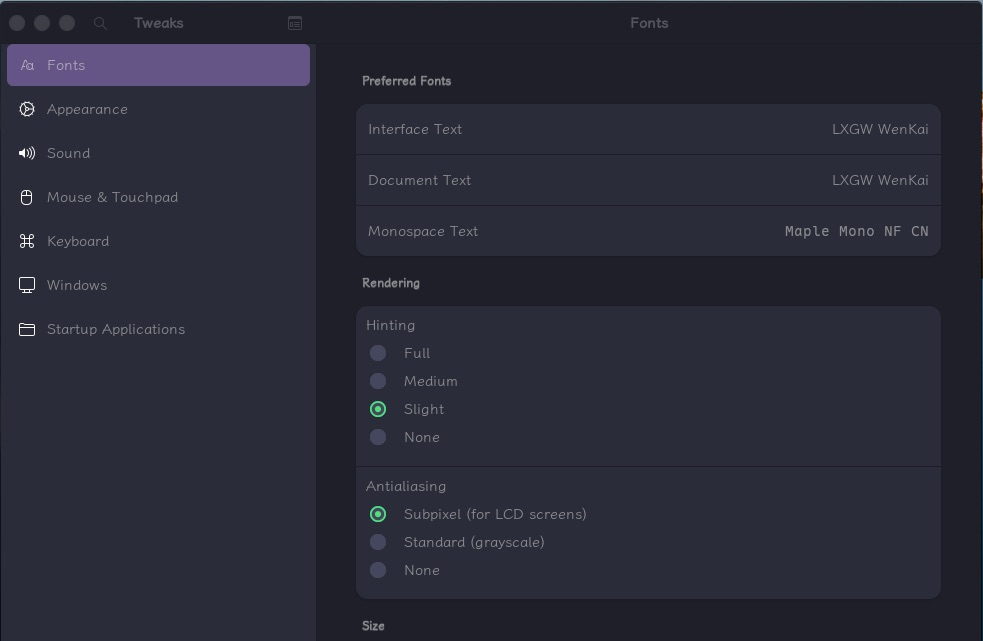

4. 配置主题，图标和光标

    - 在extension-manager中设置 `User Themes` 和 `Blur My Shell` 开启，如果是24.04.4还可以开启 `Quick Setting Tweaker`

        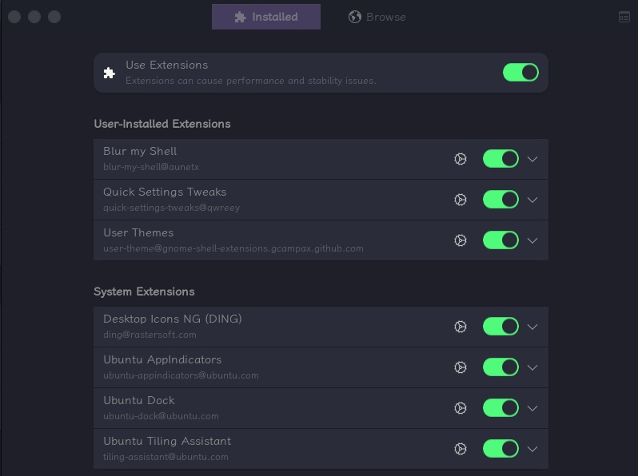

    - 在 `~/.themes` 文件夹下添加主题以及在 `~/.icons` 文件下添加图标和光标后，在Tweaks里面设置外观

        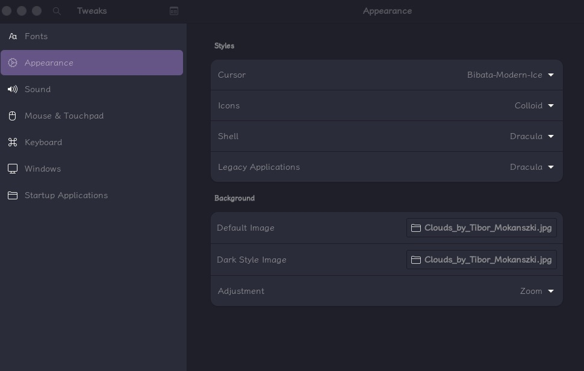

    > [!Tip]
    >
    > 对于Dracula主题的解决方案(针对24.04.4)
    >
    > **For the latest versions of Gnome using Gtk4(libadwaita) some extra steps should be done in order to get it working properly, you could do it in this way:**
    >
    > - Copy the `assets` folder to the `~/.config` directory
    > - Copy the `gtk-4.0/gtk.css` and `gtk-4.0/gtk-dark.css` files to `~/.config/gtk-4.0/`

### 中文输入法设置

- 使用apt安装fcitx5

    ```zsh
    # 24.04.4
    sudo apt install fcitx5 fcitx5-pinyin fcitx5-config-qt fcitx5-frontend-all
    
    # 22.04.5
    sudo apt install -y fcitx5 fcitx5-pinyin fcitx5-config-qt fcitx5-frontend-gtk2 fcitx5-frontend-gtk3 fcitx5-frontend-gtk4 fcitx5-frontend-qt5
    
    im-config -n fcitx5
    ```

- 在 `Fcitx 5 Configuration` 中添加拼音，同时在Global Options里面设置用 <kbd>shift</kbd> 键切换

    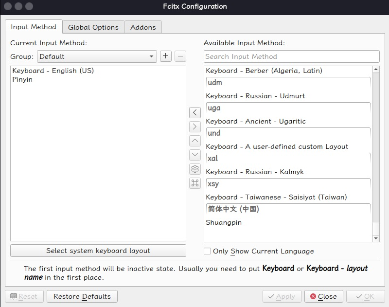


