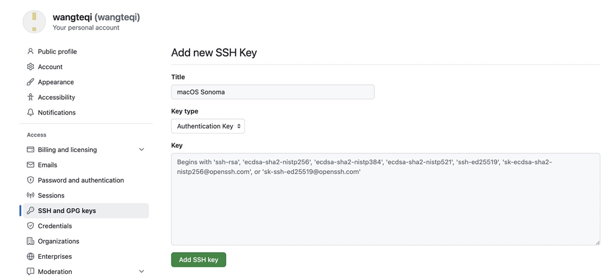

> 2023.9.3
>
> 王特起

# Git学习

## Git基础

### 配置Git

1. 查看Git的版本

    ```zsh
    git --version
    ```

2. 添加Git的用户名和邮箱

    ```zsh
    # 查看
    git config user.name
    git config user.email
    
    # 修改
    git config --global user.name wangteqi
    git config --global user.email 1591700776@qq.com
    ```

### 工作区，暂存区和本地仓库

1. 创建版本库

    ```zsh
    git init
    ```

2. 添加工作区的文件修改到暂存区

    ```zsh
    git add <file>
    ```

3. 提交暂存区的内容到本地仓库

    ```zsh
    git commit -m "<message>"
    ```

4. 查看工作区，暂存区和本地仓库的状态

    ```zsh
    git status
    ```

5. 查看提交日志

    ```zsh
    git log
    ```

6. 版本回退

    ```zsh
    git reset --hard <commit>
    ```

## Git进阶

### Git指定要忽略的文件

在Git项目中定义 `.gitignore` 文件，可以提交时忽略这些文件

```zsh
# 日志文件（用*代替文件名）
*.log

# 需要继续追踪的日志文件（前面加！）
!important.log

# 私密图片文件夹
image/
```

> [!Warning]
>
> 因为.gitignore只能忽略那些Untracked的文件，如果某些文件已经被纳入了版本管理中，则修改.gitignore是无效的。
>
> 解决方法：删除本地缓存（改变成Untrack状态）
>
> ```zsh
> git rm -r --cached .
> ```

### Git分支

1. 创建并切换分支

    ```zsh
    git switch -c <branch-name>
    ```

2. 查看分支

    ```zsh
    git branch -a
    ```

3. 切换分支

    ```zsh
    git switch <branch-name>
    ```

4. 合并分支

    ```zsh
    git merge <branch-name>
    ```

5. 删除分支

    ```zsh
    git branch -d <branch-name>
    ```

## Git远程仓库

### 配置SSH连接

在Github上创建[SSH keys](https://github.com/settings/keys)，点击 `New SSH key`



- Title：macOS Sonoma

- Key：在终端中执行下面的命令，将结果复制进去

    ```zsh
    # 查看SSH 公钥
    cat ~/.ssh/id_ed25519.pub
    
    # 如果没有结果，先生成
    ssh-keygen -o
    ```

### 上传本地仓库到代码托管平台

1. 初始化本地仓库

    ```zsh
    git init
    ```

2. 添加远程仓库

    ```zsh
    git remote add <my-repo-name> <my-repo-url>
    
    # 查看关联的远程仓库
    git remote -v
    ```

3. 从远程仓库拉取最新内容，并在main分支上合并最新内容

    ```zsh
    git fetch <my-repo-name>
    git merge <my-repo-name>/main
    ```

4. 创建并切换到新分支

    ```zsh
    git switch -c <branch-name>
    ```

5. 在新分支上修改、提交

    ```zsh
    (branch-name) git status
    (branch-name) git add .
    (branch-name) git commit -m "<message>" 
    ```

6. 切换到main分支，并在main分支上合并新开发的分支功能

    ```zsh
    git switch main
    git merge <branch-name>
    ```

7. 推送到远程仓库的main分支

    ```zsh
    git push -u <my-repo-name> main
    ```

8. 删除本地分支

    ```zsh
    git branch -d <branch-name>
    ```

### 团队项目

1. 克隆团队仓库到本地

    ```zsh
    git clone <team-repo-url> --origin <team-repo-name>
    ```

2. fork团队仓库，添加fork后的远程仓库

    ```zsh
    git remote add <my-repo-name> <my-repo-url>
    ```

3. 拉取团队仓库最新的内容，并将最新内容合并到main分支上

    ```zsh
    git fetch -p <team-repo-name>
    git merge <team-repo-name>/main
    ```

4. 创建并切换到新分支

    ```zsh
    git switch -c <branch-name>
    ```

5. 在新分支上修改、提交

    ```zsh
    (branch-name) git status
    (branch-name) git add .
    (branch-name) git commit -m "<message>"
    ```

6. 再次拉取团队仓库最新内容，并合并到新分支

    ```zsh
    (branch-name) git fetch -p <team-repo-name>
    (branch-name) git merge <team-repo-name>/main
    ```

7. 推送到fork的远程仓库的远程分支

    ```zsh
    (branch-name) git push -u <my-repo-name> <branch-name>
    ```

8. 提交PR请求通过后，更新本地仓库和远程fork的仓库

    ```zsh
    git switch main 
    git fetch -p <team-repo-name>
    git merge <team-repo-name>/main
    git push <my-repo-name> main
    ```

9. 删除本地分支和远程分支

    ```zsh
    git branch -d <branch-name>
    git push <my-repo-name> --delete <branch-name>
    ```

    


