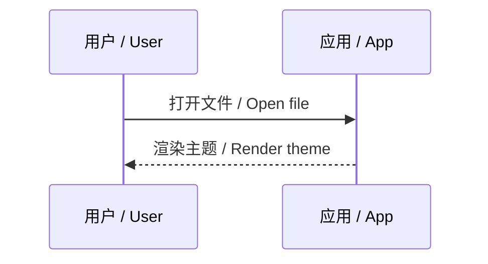
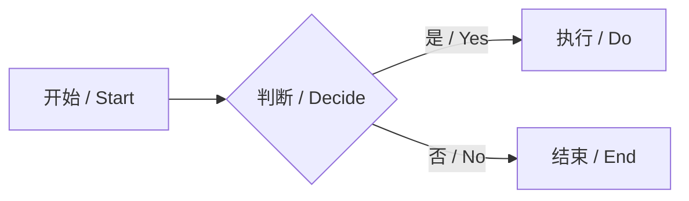

> 2023.9.4
>
> 王特起

# Markdown学习

## 标题

```markdown
# 一级标题
## 二级标题
### 三级标题
#### 四级标题
##### 五级标题
###### 六级标题
```

## 文本

### 加粗

```markdown
**这是加粗文本样式**
```

这是正常文本样式

**这是加粗文本样式**

### 下划线

```markdown
<u>这是下划线文本样式</u>
```

<u>这是下划线文本样式</u>

### 斜体

```markdown
*这是斜体文本样式*
```

*这是斜体文本样式*

### 删除线

```markdown
~~这是删除线文本样式~~
```

~~这是删除线文本样式~~

### 高亮

```markdown
==这是高亮文本样式==
```

==这是高亮文本样式==

### 键盘

```markdown
<kbd>键盘</kbd>
```

<kbd>键盘</kbd>

### 按钮

```markdown
<button>按钮</button>
```

<button>按钮</button>

### 上标和下标

```markdown
a^2^
b~3~
```

a^2^
b~3~

### 猫爪行

```markdown
---
```

---

## 列表

### 无序列表

```markdown
- 苹果 / Apple
- 香蕉 / Banana
  - 青香蕉 / Green banana
  - 熟香蕉 / Ripe banana
- 樱桃 / Cherry
```

- 苹果 / Apple
- 香蕉 / Banana
  - 青香蕉 / Green banana
  - 熟香蕉 / Ripe banana
      - 三分熟
      - 七分熟
- 樱桃 / Cherry

### 有序列表

```markdown
1. 第一步 / Step one
2. 第二步 / Step two
3. 第三步 / Step three
```

1. 第一步 / Step one
2. 第二步 / Step two
3. 第三步 / Step three

### 任务列表

```markdown
- [ ] 待办事项 / Todo item
- [x] 已完成事项 / Done item
- [ ] 另一个任务 / Another task
```

- [ ] 待办事项 / Todo item
- [x] 已完成事项 / Done item
- [ ] 另一个任务 / Another task

## 链接

### 网址/文档/标题链接

```markdown
# 网址链接
[网址名称](网址)
<网址>
# 文档链接
[文档名称](文档路径)
# 标题链接
[跳转到标题](# 标题)
```

[百度](www.baidu.com)

<www.baidu.com>

[跳转到数学公式](# 数学公式)

### 图片链接

```markdown

```

## 引用和警示框

### 引用

```markdown
> 引用
```

> 引用

### 警示框

```markdown
> [!Note]
> [!Tip]
> [!Important]
> [!Warning]
> [!Caution]
```

> [!Note]

> [!Tip]

> [!Important]

> [!Warning]

> [!Caution]

## 代码块

### 行内代码

```markdown
`行内代码`
```

`行内代码`

### 代码块

```python
a!=1
```

## 数学公式

### 行内公式

```markdown
这里求 $a^2+b_2$ 的值
```

这里求 $a^2+b_2$ 的值

### 行间公式

```markdown
方程组为：

$$
\begin{equation}
  \begin{cases}
   f(x)=1+x+x^2
   \\
   g(x)=a_nx^n+a_{n-1}x^{n-1}+...+a_1x^1
  \end{cases}
\end{equation}
$$
```

方程组为：

$$
\begin{equation}
  \begin{cases}
   f(x)=1+x+x^2
   \\
   g(x)=a_nx^n+a_{n-1}x^{n-1}+...+a_1x^1
  \end{cases}
\end{equation}
$$

## 表格

```markdown
| 项目 / Item | 数量 / Qty | 备注 / Note |
|:-:|:--:|:--:|
| 铅笔 / Pencil | 2 | HB |
| 橡皮 / Eraser | 1 | 白色 / White |
| 笔记本 / Notebook | 3 | A5 |
```


|    项目 / Item    | 数量 / Qty | 备注 / Note  |
| :---------------: | :--------: | :----------: |
|   铅笔 / Pencil   |     2      |      HB      |
|   橡皮 / Eraser   |     1      | 白色 / White |
| 笔记本 / Notebook |     3      |      A5      |

## 图表



---

---

---

---

---

---




