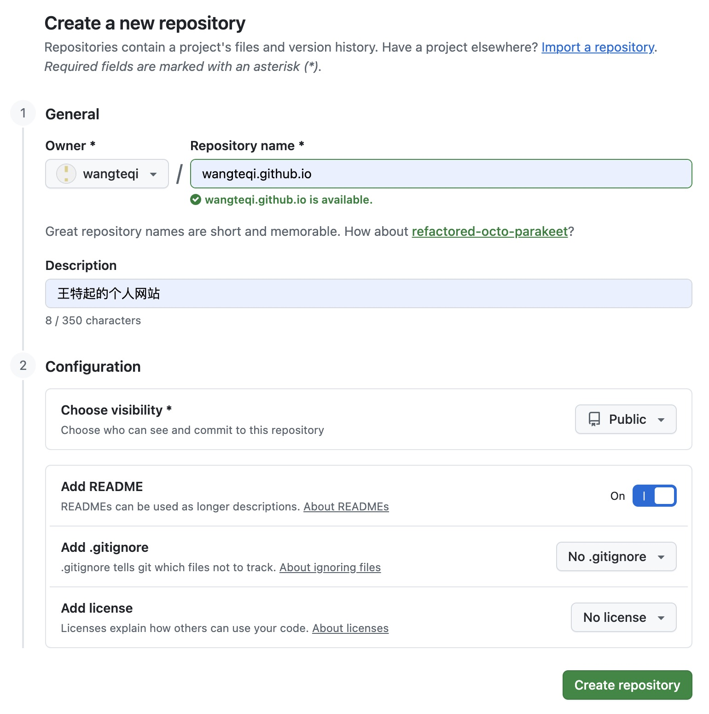
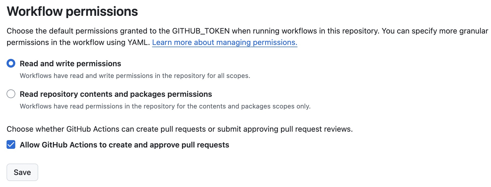
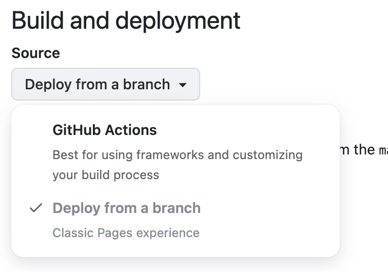

> 2023.9.5
>
> 王特起

# 个人网站搭建

## 配置Github仓库

### 创建仓库

在Github上[创建仓库](https://github.com/new)

- 设置 `Repository name`：wangteqi.github.io
- 设置 `Description`：王特起的个人网站
- 设置 `Configuration-->Add README`：On



### 配置仓库的Actions权限

在创建的Github仓库 `Settings-->Actions-->General` 中配置 `Workflow permisssions` 



### 配置Pages

在创建的Github仓库 `Settings-->Pages-->Build and deployment` 中配置 `Source` 为 ==Github Actions==



## Zensical搭建网站

### 安装

1. 创建虚拟环境

    ```zsh
    # conda
    conda create -n zensical python=3.12
    # 激活环境
    conda activate zensical
    
    # uv
    uv init ~/QiQ/CodeVault/MyWebsite --bare --python 3.12 --pin-python
    # 激活环境
    source .venv/bin/activate
    ```

2. 在虚拟环境中安装

    ```zsh
    # conda
    pip install zensical
    
    # uv
    uv add --dev zensical
    ```

3. 在PyCharm项目文件下初始化

    ```zsh
    # conda
    zensical new .
    
    # uv 
    uv run zensical new .
    ```


### 工作流文件

- 文件路径：`./github/workflows/docs.yml`

- 文件内容（在原始文件做了以下修改）

    - 修改工作流名称为 ==website-publish==
    - 添加 ==注释==
    
    ```yml
    # 定义工作流名称
    name: website-publish
    # 触发条件，这个工作流会在每次向仓库main/master分支推送代码时触发
    on:
      push:
        branches:
          - master
          - main
    # 权限
    permissions:
      contents: read
      pages: write
      id-token: write
    # 构建工作流中的任务
    jobs:
      # 任务名称
      deploy:
        # 指定环境
        environment:
          name: github-pages
          url: ${{ steps.deployment.outputs.page_url }}
        # 指定了运行该任务的虚拟环境是最新版本的Ubuntu
        runs-on: ubuntu-latest
        # 执行步骤
        steps:
          - uses: actions/configure-pages@v6
          - uses: actions/checkout@v7
          - uses: actions/setup-python@v6
            with:
              python-version: 3.x
          - run: pip install zensical
          - run: zensical build --clean
          - uses: actions/upload-pages-artifact@v5
            with:
              path: site
          - uses: actions/deploy-pages@v5
            id: deployment
            
    ```

### Zensical配置文件

- 文件路径：`./zensical.toml`

- 文件内容

    ```toml
    [project]
    # 网站名称
    site_name = "王特起的个人网站"
    # 网站地址
    site_url = "https://wangteqi.github.io"
    # 网站说明
    site_description = "记录日常"
    # 网站作者
    site_author = "王特起"
    # Github仓库名称
    repo_name = "wangteqi/wangteqi.github.io"
    # Github仓库地址
    repo_url = "https://github.com/wangteqi/wangteqi.github.io"
    # 指定 GitHub 分支和 Markdown 文件目录
    edit_uri = "edit/main/docs/"
    # css配置
    extra_css = ["assets/stylesheets/extra.css"]
    # JavaScript配置
    extra_javascript = [
        "assets/javascripts/mathjax.js",
        "https://unpkg.com/mathjax@3/es5/tex-mml-chtml.js"
    ]
    # 版权信息
    copyright = "Copyright &copy; 2026 ~ now  |  王特起"
    
    #######################################################################################################
    ##########################################平时修改部分###################################################
    # 显式导航
    nav = [
        { "首页" = "index.md" },
        { "开发技术" = [
            { "开发技术总览" = "dev/index.md" },
            { "操作系统与环境" = [
                { "macOS 配置" = "dev/system/macos.md" },
                { "Ubuntu 配置" = "dev/system/ubuntu.md" }
            ] },
            { "开发工具基础" = [
                { "Git 基础" = "dev/tools/git.md" },
                { "Markdown 基础" = "dev/tools/markdown.md" },
                { "网站搭建基础" = "dev/tools/website.md" }
            ] }
        ] },
        { "个人研究" = [
            { "个人研究总览" = "research/index.md" },
            { "深度学习基础" = [
                { "服务器配置" = "research/deep-learning/server.md" },
                { "Python学习" = "research/deep-learning/python.md" },
                { "Numpy学习" = "research/deep-learning/numpy.md" },
                { "Pytorch学习" = "research/deep-learning/pytorch.md" },
                { "反向传播算法" = "research/deep-learning/bp.md" },
                { "计算机视觉学习" = "research/deep-learning/cv.md" },
                { "自然语言处理学习" = "research/deep-learning/nlp.md" },
                { "模型训练流程" = "research/deep-learning/pipeline.md" }
            ] }
        ] }
    ]
    
    # 标签
    [project.extra.tags]
    system = "tags-system"
    tools = "tags-tools"
    deep-learning = "tags-deep-learning"
    robot-policy = "tags-robot-policy"
    projects = "tags-projects"
    [project.theme.icon.tag]
    default = "lucide/tag"
    tags-system = "fontawesome/solid/gears"
    tags-tools = "fontawesome/brands/dev"
    tags-deep-learning = "fontawesome/solid/user-astronaut"
    tags-robot-policy = "fontawesome/brands/bots"
    tags-projects = "fontawesome/solid/laptop-file"
    ##########################################平时修改部分###################################################
    #######################################################################################################
    
    # 社交链接
    [[project.extra.social]]
    icon = "fontawesome/brands/github"
    link = "https://github.com/wangteqi"
    name = "github.com"
    [[project.extra.social]]
    icon = "fontawesome/brands/x-twitter"
    link = "https://x.com/teqiwang"
    name = "x.com"
    
    [project.theme]
    # 现代主题
    variant = "modern"
    # 禁止从 Google Fonts 加载字体，改用本地字体
    font = false
    # 网站语言
    language = "zh"
    # 主题功能
    features = [
        # 页脚
        "navigation.footer",
        # 查看/编辑页面源码
        "content.action.view",
        "content.action.edit",
        # 页面切换
        "navigation.instant",
        "navigation.instant.prefetch",
        "navigation.instant.progress",
        # 顶部导航
        "navigation.tabs",
        # 导航结构
        "navigation.tracking",
        "navigation.sections",
        "navigation.path",
        "navigation.indexes",
        # 阅读体验
        "toc.follow",
        "navigation.top",
        # 搜索
        "search.highlight",
        # 选择/复制代码
        "content.code.select",
        "content.code.copy",
        # 同步内容选项卡
        "content.tabs.link",
        # 脚注悬浮提示
        "content.footnote.tooltips",
        # 悬浮提示
        "content.tooltips"
    ]
    
    # 跟随系统主题
    [[project.theme.palette]]
    media = "(prefers-color-scheme)"
    toggle.icon = "lucide/sun-moon"
    toggle.name = "Switch to light mode"
    # 浅色主题
    [[project.theme.palette]]
    media = "(prefers-color-scheme: light)"
    scheme = "default"
    toggle.icon = "lucide/sun"
    toggle.name = "Switch to dark mode"
    # 深色主题
    [[project.theme.palette]]
    media = "(prefers-color-scheme: dark)"
    scheme = "slate"
    toggle.icon = "lucide/moon"
    toggle.name = "Switch to system preference"
    
    # 图标
    [project.theme.icon]
    logo = "lucide/sparkles"
    repo = "fontawesome/brands/github-alt"
    view = "material/eye"
    edit = "material/pencil"
    
    # Markdown基础扩展
    [project.markdown_extensions.abbr]
    [project.markdown_extensions.admonition]
    [project.markdown_extensions.attr_list]
    [project.markdown_extensions.def_list]
    [project.markdown_extensions.footnotes]
    [project.markdown_extensions.md_in_html]
    [project.markdown_extensions.toc]
    title = "目录"
    permalink = "⚓︎"
    permalink_title = "Anchor link to this section"
    [project.markdown_extensions.toc.slugify]
    object = "pymdownx.slugs.slugify"
    kwds = { case = "lower" }
    [project.markdown_extensions.tables]
    # Markdown额外扩展
    [project.markdown_extensions.pymdownx.arithmatex]
    generic = true
    [project.markdown_extensions.pymdownx.blocks.caption]
    [project.markdown_extensions.pymdownx.betterem]
    [project.markdown_extensions.pymdownx.caret]
    [project.markdown_extensions.pymdownx.mark]
    [project.markdown_extensions.pymdownx.tilde]
    [project.markdown_extensions.pymdownx.details]
    [project.markdown_extensions.pymdownx.emoji]
    emoji_index = "zensical.extensions.emoji.twemoji"
    emoji_generator = "zensical.extensions.emoji.to_svg"
    [project.markdown_extensions.pymdownx.highlight]
    pygments_lang_class = true
    anchor_linenums = true
    line_spans = "__span"
    [project.markdown_extensions.pymdownx.inlinehilite]
    [project.markdown_extensions.pymdownx.keys]
    [project.markdown_extensions.pymdownx.smartsymbols]
    [project.markdown_extensions.pymdownx.snippets]
    auto_append = ["docs/assets/abbreviations.md"]
    [project.markdown_extensions.pymdownx.superfences]
    custom_fences = [
        { name = "mermaid", class = "mermaid", format = "pymdownx.superfences.fence_code_format" }
    ]
    [project.markdown_extensions.pymdownx.tabbed]
    alternate_style = true
    combine_header_slug = true
    [project.markdown_extensions.pymdownx.tabbed.slugify]
    object = "pymdownx.slugs.slugify"
    kwds = { case = "lower" }
    [project.markdown_extensions.pymdownx.tasklist]
    custom_checkbox = true
    ```
    
- 后续添加笔记

    - ==显式导航== 部分按需添加

        > [!Note]
        >
        > 可以在 `extra.css` 文件中对相应文档的图标颜色进行修改

    - ==标签== 部分按需添加

### js文件配置

- 目前用于数学公式

- 文件路径：`./docs/assets/javascripts/mathjax.js`

- 文件内容

    ```js
    // 支持数学公式
    window.MathJax = {
        tex: {
            inlineMath: [["\\(", "\\)"]],
            displayMath: [["\\[", "\\]"]],
            processEscapes: true,
            processEnvironments: true
        },
        options: {
            ignoreHtmlClass: ".*|",
            processHtmlClass: "arithmatex"
        }
    };
    
    document$.subscribe(() => {
        MathJax.startup.output.clearCache()
        MathJax.typesetClear()
        MathJax.texReset()
        MathJax.typesetPromise()
    })
    
    component$.subscribe(({ref}) => {
        if (ref.classList.contains("md-annotation"))
            MathJax.typesetPromise([ref])
    })
    ```

### css文件配置

- 目前用于字体修改，Logo 图标颜色修改，Repo 图标颜色修改，文档图标颜色修改

- 文件路径：`./docs/assets/stylesheets/extra.css`

- 字体文件夹：`./docs/assets/fonts`

- 文件内容

    ```css
    /* ================================本地字体================================ */
    @font-face {
        font-family: "LXGW WenKai";
        src: url("../fonts/LXGWWenKai/LXGWWenKai-Regular.ttf")
             format("truetype");
        font-weight: 400;
        font-style: normal;
        font-display: swap;
    }
    
    @font-face {
        font-family: "LXGW WenKai";
        src: url("../fonts/LXGWWenKai/LXGWWenKai-Medium.ttf")
             format("truetype");
        font-weight: 500;
        font-style: normal;
        font-display: swap;
    }
    
    @font-face {
        font-family: "Maple Mono NF CN";
        src: url("../fonts/MapleMono-NF-CN/MapleMono-NF-CN-Regular.ttf")
             format("truetype");
        font-weight: 400;
        font-style: normal;
        font-display: swap;
    }
    
    @font-face {
        font-family: "Maple Mono NF CN";
        src: url("../fonts/MapleMono-NF-CN/MapleMono-NF-CN-Bold.ttf")
             format("truetype");
        font-weight: 700;
        font-style: normal;
        font-display: swap;
    }
    
    @font-face {
        font-family: "Maple Mono NF CN";
        src: url("../fonts/MapleMono-NF-CN/MapleMono-NF-CN-Italic.ttf")
             format("truetype");
        font-weight: 400;
        font-style: italic;
        font-display: swap;
    }
    
    @font-face {
        font-family: "Maple Mono NF CN";
        src: url("../fonts/MapleMono-NF-CN/MapleMono-NF-CN-BoldItalic.ttf")
             format("truetype");
        font-weight: 700;
        font-style: italic;
        font-display: swap;
    }
    
    :root {
        /* 正文、标题、导航栏、目录 */
        --md-text-font: "LXGW WenKai";
        /* 代码块、行内代码 */
        --md-code-font: "Maple Mono NF CN";
    }
    
    /* ================================图标颜色================================ */
    /* Logo 图标颜色 */
    .md-header__button.md-logo,
    .md-nav__button.md-logo {
        color: #f59e0b;
    }
    
    /* Repo 图标颜色 */
    .md-header__source .md-source__icon,
    .md-nav__source .md-source__icon {
        color: #8b5cf6;
    }
    
    /* macos 文档图标颜色 */
    .md-nav__link[href*="/macos/"] svg,
    .md-nav__link[href*="/ubuntu/"] svg,
    .md-nav__link[href*="/git/"] svg,
    .md-nav__link[href*="/markdown/"] svg,
    .md-nav__link[href*="/website/"] svg,
    .md-nav__link[href*="/server/"] svg,
    .md-nav__link[href*="/python/"] svg,
    .md-nav__link[href*="/numpy/"] svg,
    .md-nav__link[href*="/pytorch/"] svg,
    .md-nav__link[href*="/bp/"] svg,
    .md-nav__link[href*="/cv/"] svg,
    .md-nav__link[href*="/nlp/"] svg,
    .md-nav__link[href*="/pipeline/"] svg {
      color: #097acb;
    }
    ```

### 缩略词文件配置

- 文件路径：`./docs/assets/abbreviations.md`

- 文件内容

    ```markdown
    *[ACT]: Action Chunking with Transformers
    ```

## 使用Git发布网站

### 首次发布

1. 创建git忽略文件

    - 文件路径：`./.gitignore`

    - 文件内容

        ```zsh
        # macos文件
        .DS_Store
        
        # pycharm文件夹
        .idea/
        ```

2. 初始化本地仓库

    ```zsh
    git init
    ```

3. 添加远程仓库

    ```zsh
    git remote add wtq git@github.com:wangteqi/wangteqi.github.io.git
    ```

4. 从远程仓库拉取最新内容，并在main分支上合并最新内容

    ```zsh
    git fetch wtq
    git merge wtq/main
    ```

5. 在main分支上提交

    ```zsh
    git status
    git add .
    git commit -m "Init website"
    ```

6. 推送到远程仓库

    ```zsh
    git push -u wtq main
    ```

### 后续添加内容后发布

1. 从远程仓库拉取最新内容，并在main分支上合并新内容

    ```zsh
    git fetch wtq
    git merge wtq/main
    ```

2. 创建并切换到新分支

    ```zsh
    git switch -c <branch-name>
    ```

3. 在新分支上添加内容后提交

    ```zsh
    (branch-name) git add .
    (branch-name) git commit -m "Add new files"
    ```

4. 切换到main分支，并在main分支上合并新分支添加的内容

    ```zsh
    git switch main
    git merge <branch-name>
    ```

5. 推送到远程仓库的main分支

    ```zsh
    git push wtq main
    ```

6. 删除本地分支

    ```zsh
    git branch -d <branch-name>
    ```

    


