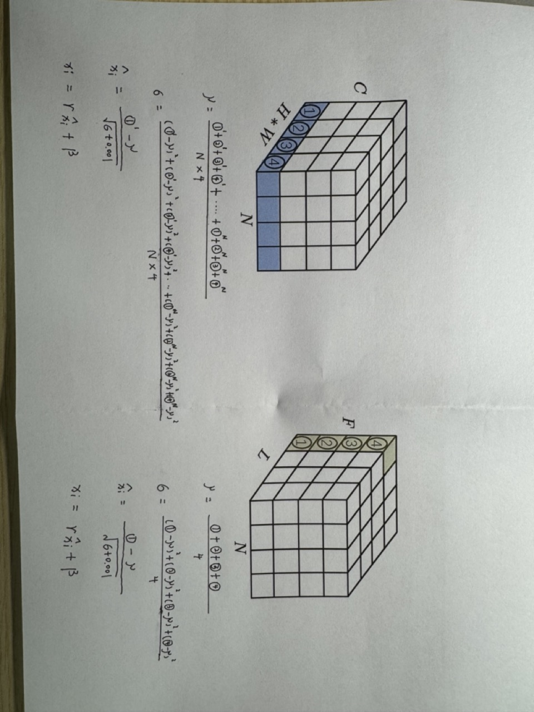

> 2023.9.11
>
> 王特起

# 计算机视觉学习

## 分类问题

### 逻辑斯蒂回归

给定 ==两个特征== $x_{1}$ 和 $x_{2}$，该模型将拟合 ==线性回归==，使其输出为logit(z)，使用Sigmoid函数将其转换为 ==概率==


$$
P\left( y=1 \right) =\sigma \left( z \right) =\sigma (b+w_{1}x_{1}+w_{2}x_{2})
$$


1. 对数比值比函数

    将 ==概率== 映射到 ==对数比值比==，且对称。==logit值就是对数比值比==

2. Sigmoid函数

    将 ==对数比值比== 映射回 ==概率==

3. 决策边界

    z等于0，就处于 ==决策边界==

### 二元交叉熵损失

1. 误差

    预测 ==接近1的概率==，当概率为1意味着 ==0损失==

    - $\text{正类误差}_{i}=\text{log}(P(y_{i}=1))$
    - $\text{负类误差}_{i}=\text{log}(1-P(y_{i}=1))$

2. 损失

    表达式

    
    $$
    \text{BCE} \left( y \right) =-\frac{1}{N_{\text{正}}+N_{\text{负}}} \left[ \sum_{i=1}^{N_{\text{正}}} \text{log} \left( P\left( y_{i}=1 \right) \right) +\sum_{i=1}^{N_{\text{负}}} \text{log} \left( 1-P\left( y_{i}=1 \right) \right) \right]
    $$
    
    等价形式
    
    
    $$
    \text{BCE} \left( y \right) =-\frac{1}{N} \sum_{i=1}^{N} \left[ y_{i}\text{log} \left( P\left( y_{i}=1 \right) \right) +\left( 1-y_{i} \right) \text{log} \left( 1-P\left( y_{i}=1 \right) \right) \right]
    $$
    
    
3. 损失函数类

    - `nn.BCEWithLogitsLoss`，最后一层 ==没有== Sigmoid层
    - 损失函数要确保 ==第一个参数是预测值==
    - 输入是 ==logit==，标签是 ==浮点数==

### 交叉熵损失

1. sofmax函数计算概率

    表达式

    
    $$
    \text{softmax} \left( z_{i} \right) =\frac{e^{z_{i}}}{\sum\nolimits_{j}^{C-1} e^{z_{j}}}
    $$
    
2. 损失

    表达式

    
    $$
    \text{CE} \left( y \right) =-\frac{1}{N_{0}+\cdots +N_{C-1}} \sum_{c=0}^{C-1} \sum_{i=1}^{N_{c}} \text{log} \left( P\left( y_{i}=c \right) \right)
    $$
    
3. 损失函数类

    - `nn.CrossEntropyloss()`，最后一层 ==没有== LogSoftmax层
    - 输入是 ==logit==，标签是 ==长整形==

## 激活函数

仿射变化：线性变换 $w^{T}x$ +平移 $b$，神经元 ==只能== 进行仿射变化

决策边界：在 ==激活== 特征空间的一条 ==直线==，在 ==原始== 特征空间是一条 ==曲线==

> [!Note]
>
> 激活函数是 ==非线性函数==，==扭曲和转动== 特征空间得到 ==激活特征空间==，打破深层和浅层模型的 ==等价性==

## 卷积神经网络

### 卷积

1. 使用 `nn.Conv2d()` 定义卷积层

    - `in_chanels` 定义输入通道数
    - `out_chanels` 定义输出通道数
    - `kernel_size` 定义卷积核大小
    - `stride` 定义步幅
    - `padding` 定义填充大小

2. 卷积后的形状

   
    $$
    \left( \frac{\left( h+2p \right) -f}{s} +1,\frac{\left( w+2p \right) -f}{s} +1 \right)
    $$
    

    > [!Tip]
    >
    > 若要保持卷积后图像 ==大小不变==，需要设置 $p=\frac{f-1}{2} ,s=1$

### 池化

1. 最大池化 `nn.MaxPool2d()`
2. 平均池化 `nn.AvgPool2d()`

### 展平层

`nn.Flatten()`

### 丢弃

`nn.Dropout(p)` 用来作 ==正则化器==，通过强制模型找到不止一种方法实现目标来 ==防止过拟合==

> [!Important]
>
> ==验证== 模式没有丢弃，所以需要 ==设置== 模型模式

### 恒等层

`nn.Identity()`

### 1X1卷积

可以 ==减少== 通道的数量，作为 ==降维层== 使用

### 批归一化和层归一化

1. 批归一化

    对于 ==每个通道==，计算 ==这个小批量下该通道所有元素== 的均值和方差，然后执行 ==仿射变换==

    - 上一层设置 `bias = False`

    - 一般在激活函数 ==之前== 使用

    - 使用 `nn.BatchNorm2d(num_features)` 进行归一化

         `num_features` 参数必须与 ==输入的通道数== 匹配

2. 层归一化

    对于 ==每个数据点==，计算 ==这个数据点下所有特征== 的均值和方差，然后执行 ==仿射变换==

    - 使用 `nn.LayerNorm(d_model)`  进行归一化



### 残差连接

引入 ==非线性== 会导致无法学习 ==恒等函数==，引入残差连接可以 ==跳过== 非线性

> [!Note]
>
> 通俗一点的例子：对于 ==线性层+relu激活函数== $F(x)$，加入 ==残差== $x$ 可以让 ==线性层== 只学习到 ==产生负值==，然后负值经过relu激活函数会被 ==截断==，即拟合到 $F(x)=0$，最终输出 $F(x)+x$ 就会 ==恒等== 于输入值

1. 残差网络
    - 为梯度返回原始层提供了 ==更短== 的路径，防止深层网络的 ==梯度消失==
    - 需要 ==下采样==，保持相加图片的尺寸一致
    - 加入残差 ==之后== 需要接激活函数，保证非线性

### 模型冻结

1. 冻结所有参数

    使用 `param.requires_grad=False` 来 ==冻结== 参数

### 梯度爆炸和梯度消失

1. 梯度消失

    对于深层模型，为 ==初始层== 中的权重计算的 ==梯度== 会 ==越来越小==，最后导致权重 ==不更新==

    - 权重初始化

        - Kaiming初始化

            初始化权重 `nn.init.kaiming.uniform_()`

            初始化偏差 `nn.init.zeros_()`

        - 初始化函数的封装

            ```python
            def weights_init(m):
                if isinstance(m, nn.Linear):
                    nn.init.kaiming_uniform_(m.weight, nonlinearity='relu')
                    if m.bias is not None:
                        nn.init.zeros_(m.bias)
            ```

        - 应用初始化函数

            `model.apply(weights_init)`

    - 批归一化

2. 梯度爆炸

    对于深层模型，一个大的梯度可能会 ==不受控制增长==

    - 梯度裁剪

        梯度裁剪发生在计算梯度 ==之后==，更新参数 ==之前==

        - 值裁剪

            `nn.utils.clip_grad_value_()`

            修改后的梯度方向 ==不同==

        - 范数裁剪

            `nn.utils.clip_grad_norm_()`

            ==保留== 梯度向量的方向

    - 反向传播期间裁剪梯度

        因为普通梯度裁剪只会在 ==参数更新前== 被裁剪，不适用于 ==循环神经网络==，所以需要使用钩子来裁剪梯度

        ```python
        def set_clip_backprop(self, clip_value):
            if self.clipping is None:
                self.clipping = []
            for p in self.model.parameters():
                if p.requires_grad:
                    func = lambda grad: torch.clamp(grad, -clip_value, clip_value)
                    handle = p.register_hook(func)
                    self.clipping.append(handle)
        ```

## 钩子

### 输出钩子(一层一个钩子)

1. 钩子函数接收的参数

    在钩子函数 ==外部== 定义一个或多个 ==储存字典== 来保存下面的信息：

    - 挂钩层
    - 挂钩层输入
    - 挂钩层输出

2. 钩子函数的内部处理

    ==挂钩层的名称== 作为存储字典的键，==挂钩层的输出== 作为存储字典的值

3. 注册钩子函数，挂钩层输出

    使用 `handles = layer.register_forward_hook()` 将钩子函数和 ==对应层挂钩==，并将 ==挂钩层的句柄== 保存在句柄字典中。==层名== 作为键，==句柄== 作为值

4. `.remove()` 移除注册的钩子

```python
# 输入/输出钩子
def attach_io_hooks(model, hooked_layer_names):
    # 中间层的钩子捕获结果
    io_hook_results = defaultdict(list)
    # 中间层对应的钩子句柄
    io_hook_handles = {}

    # 中间层前向钩子函数的高阶函数
    def _make_io_hook(layer_name):
        def io_hook(layer, inputs, outputs):
            # 保存当前 batch 的中间层输入
            io_hook_results[f'{layer_name}.input'].append(inputs[0].clone().detach().cpu())

            # 保存当前 batch 的中间层输出
            io_hook_results[f'{layer_name}.output'].append(outputs.clone().detach(s).cpu())

        return io_hook

    # 遍历模型中的所有中间层
    for layer_name, layer in model.named_modules():
        # 判断当前层是否需要注册钩子
        if layer_name in hooked_layer_names:
            # 创建当前中间层对应的前向钩子函数
            io_hook = _make_io_hook(layer_name)

            # 注册前向钩子，并保存钩子句柄
            io_hook_handles[layer_name] = layer.register_forward_hook(io_hook)

    return io_hook_results, io_hook_handles
```

### 梯度钩子(层中一个参数一个钩子)

1. 钩子函数接收的参数

    - 梯度

2. 钩子函数的内部处理

    ==挂钩参数的名称== 作为字典的键，==挂钩参数的梯度== 作为存储字典的值

3. 注册钩子函数，挂钩梯度

    使用 `handles = param.registerhook()` 将钩子函数和 ==对应参数梯度挂钩==，并将 ==挂钩参数的句柄== 保存在字典中。==挂钩参数名== 作为键，==句柄== 为值

```python
# 梯度钩子
def attach_grad_hooks(model, hooked_layer_names):
    # 中间层参数的梯度捕获结果
    grad_hook_results = defaultdict(list)
    # 中间层参数对应的钩子句柄
    grad_hook_handles = {}

    # 参数梯度钩子函数的高阶函数
    def make_grad_hook(layer_name, param_name):
        def grad_hook(grad):
            # 保存当前参数的梯度
            grad_hook_results[f'{layer_name}.{param_name}.grad'].append(grad.clone().detach().cpu())

        return grad_hook

    # 遍历模型中的所有中间层
    for layer_name, layer in model.named_modules():
        # 判断当前层是否需要注册钩子
        if layer_name in hooked_layer_names:
            # 遍历当前层的参数
            for param_name, param in layer.named_parameters():
                # 判断当前参数是否需要计算梯度
                if param.requires_grad:
                    # 创建当前参数对应的梯度钩子函数
                    grad_hook = make_grad_hook(layer_name, param_name)

                    # 注册参数梯度钩子，并保存钩子句柄
                    grad_hook_handles[f'{layer_name}.{param_name}'] = param.register_hook(grad_hook)

    return grad_hook_results, grad_hook_handles
```

### 参数钩子(一层一个钩子)

1. 钩子函数接收的参数

    - 挂钩层
    - 挂钩层输入
    - 挂钩层输出

2. 钩子函数的内部处理

    ==挂钩参数的名称== 作为字典的键，==挂钩参数的值== 作为存储字典的值

3. 注册钩子函数，挂钩参数

    使用 `handles = layer.register_forward_hook()` 将钩子函数和  ==对应层挂钩==，然后记录 ==挂钩参数值==，并将 ==挂钩参数的句柄== 保存在字典中。==挂钩参数名== 为键，==句柄== 为值

```python
# 参数钩子
def attach_param_hooks(model, hooked_layer_names):
    # 中间层的参数捕获结果
    param_hook_results = defaultdict(list)
    # 中间层对应的钩子句柄
    param_hook_handles = {}

    # 中间层参数钩子函数的高阶函数
    def _make_param_hook(layer_name):
        def param_hook(layer, inputs, output):
            # 遍历当前层的参数
            for param_name, param in layer.named_parameters():
                # 保存当前层的参数
                param_hook_results[f'{layer_name}.{param_name}'].append(param.clone().detach().cpu())

        return param_hook

    # 遍历模型中的所有中间层
    for layer_name, layer in model.named_modules():
        # 判断当前层是否需要注册钩子
        if layer_name in hooked_layer_names:
            # 创建当前中间层对应的前向钩子函数
            param_hook = _make_param_hook(layer_name)

            # 注册前向钩子，并保存钩子句柄
            param_hook_handles[layer_name] = layer.register_forward_hook(param_hook)

    return param_hook_results, param_hook_handles
```

移除钩子

```python
# 移除钩子
def remove_hooks(hook_handles):
    # 移除钩子句柄
    for handle in hook_handles.values():
        handle.remove()
    # 清空句柄字典
    hook_handles.clear()
```


