> 2023.9.6
>
> 王特起

# 服务器配置

## 软件设置

### 重装

1. 删除个人文件夹中所有文件

    ```bash
    # 显示所有文件
    ls -al
    # 删除可见文件
    rm -rf *
    # 删除隐藏文件
    rm -rf .*
    ```

2. 如果有权限，可以删除并新建个人文件夹（如果没有，可以跳过)

    ```bash
    # 删除和新建文件夹
    cd ..
    sudo rm -rf wangteqi
    sudo mkdir wangteqi
    # 新建的文件夹属于root用户,需修改成个人文件夹的用户名和组名（不然没有上传文件的权限）,然后重开终端
    sudo chown wangteqi:wangteqi wangteqi
    ```

3. 添加初始化文件

    ```bash
    # 在个人文件夹下面，把初始化文件重新添加到文件夹，然后重开终端
    cp -a /etc/skel/. ~
    ```

4. 修改项目文件夹权限

    ```bash
    chmod 700 
    ```

### SSH反向端口转发

1. 本地建立SSH反向隧道

    ```zsh
    ssh -N -R 7897:127.0.0.1:7897 wtq@223.3.74.184
    ```

2. 服务器设置环境变量

    ```bash
    export https_proxy=http://127.0.0.1:7897 http_proxy=http://127.0.0.1:7897 all_proxy=socks5://127.0.0.1:7897
    ```

### 安装Miniforge

1. 下载安装脚本

    ```bash
    # 从 conda-forge 的 GitHub 页面下载 Miniforge 安装脚本
    wget "https://github.com/conda-forge/miniforge/releases/latest/download/Miniforge3-$(uname)-$(uname -m).sh"
    ```

2. 运行脚本

    ```bash
    # 运行刚下载的 Miniforge 安装脚本
    bash Miniforge3-$(uname)-$(uname -m).sh
    ```

4. 删除脚本

    ```bsah
    rm -rf Miniforge3-$(uname)-$(uname -m).sh
    ```

### 安装UV

```zsh
curl -LsSf https://astral.sh/uv/install.sh | sh
```

### 安装Pytorch

1. 检查服务器上的驱动版本可以支持的最高CUDA版本

    [驱动版本与CUDA版本对照表](https://docs.nvidia.com/cuda/cuda-toolkit-release-notes/index.html)

2. 创建虚拟环境

    ```bash
    # conda创建虚拟环境
    conda create -n pytorch python=3.12
    # 激活conda虚拟环境
    conda activate dl-demo
    
    # uv创建虚拟环境
    uv init  ~/DL-Demo --bare --python 3.12 --pin-python
    # 激活uv虚拟环境
    source .venv/bin/activate
    ```
    
3. 安装

    ```bash
    # conda安装对应的包
    pip install torch==2.11.0 torchvision==0.26.0 --index-url https://download.pytorch.org/whl/cu126
    
    # uv安装对应的包
    uv add torch==2.11.0 torchvision==0.26.0 --index pyotrch-cu126=https://download.pytorch.org/whl/cu126
    # 同时在pyproject.toml的[[tool.uv.index]]中添加
    explicit = true
    ```

### Tmux使用

> [!Tip]
>
> ==要在非虚拟环境下创建==（因为base环境也是虚拟环境)，不然Python的版本有问题

1. 创建Tmux会话

    ```bash
    # 新建一个Tmux会话
    conda deactivate
    tmux new -s train
    ```

2. 在Tmux会话中激活虚拟环境

    ```bash
    conda activate pytorch
    ```

3. 退出Tmux会话

    ```bash
    # 退出tmux会话
    tmux detach
    # 训练时退出会话
    Ctrl+b → d
    ```

4. 重新进入Tmux会话

    ```bash
    # 重新进入tmux
    tmux a -t train
    ```

5. 查看现有会话

    ```bash
    # 查看现有会话
    tmux ls
    ```

6. 删除Tmux会话

    ```bash
    # 关闭创建的tmux
    tmux kill-session -t train
    ```

## VS Code中使用服务器

### 本地解释器配置

1. 安装Python插件
2. 选择虚拟环境中的解释器

### 远程服务器连接

1. 安装Remote - SSH插件

    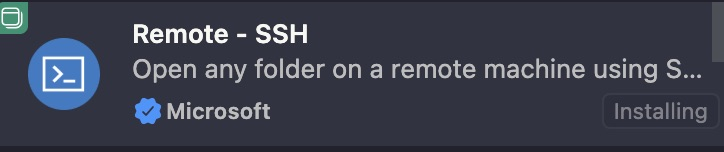

2. 打开 `远程资源管理器-->SSH-->New Remote`  添加服务器IP

    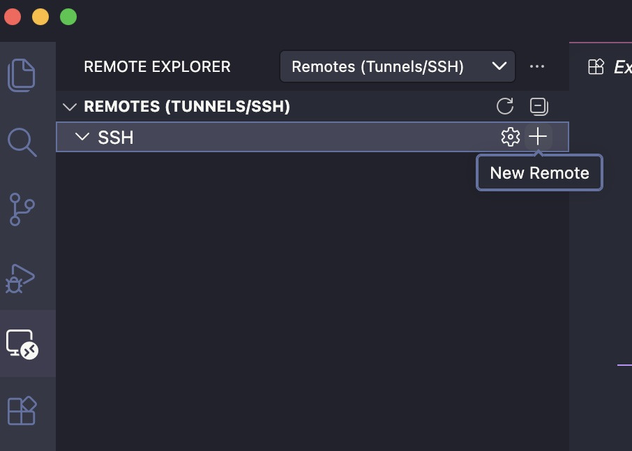

3. 点击 `Connect in New Window`  输入密码连接到远程服务器

    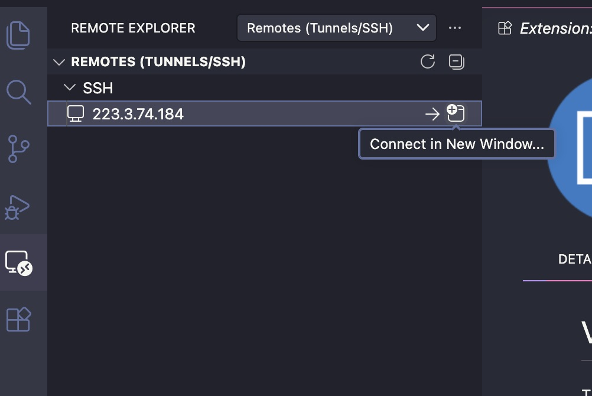

4. 在 `Open Folder` 中打开远程项目文件夹

    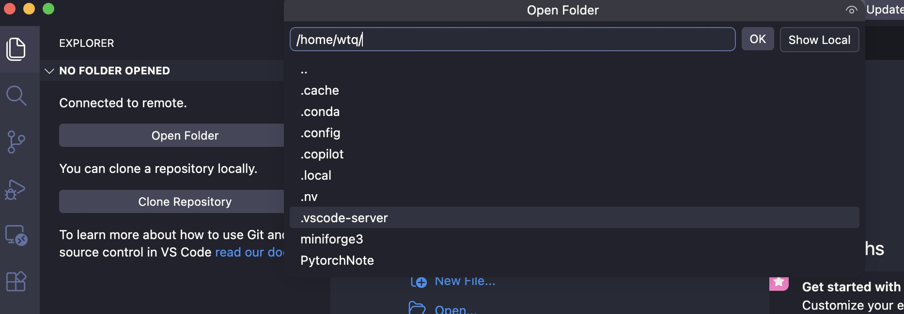

## Pycharm中使用服务器

### 远程服务器连接

1. 在 `Tools-->Deployment-->Configuration` 中添加SFTP，名称为Server-3090

    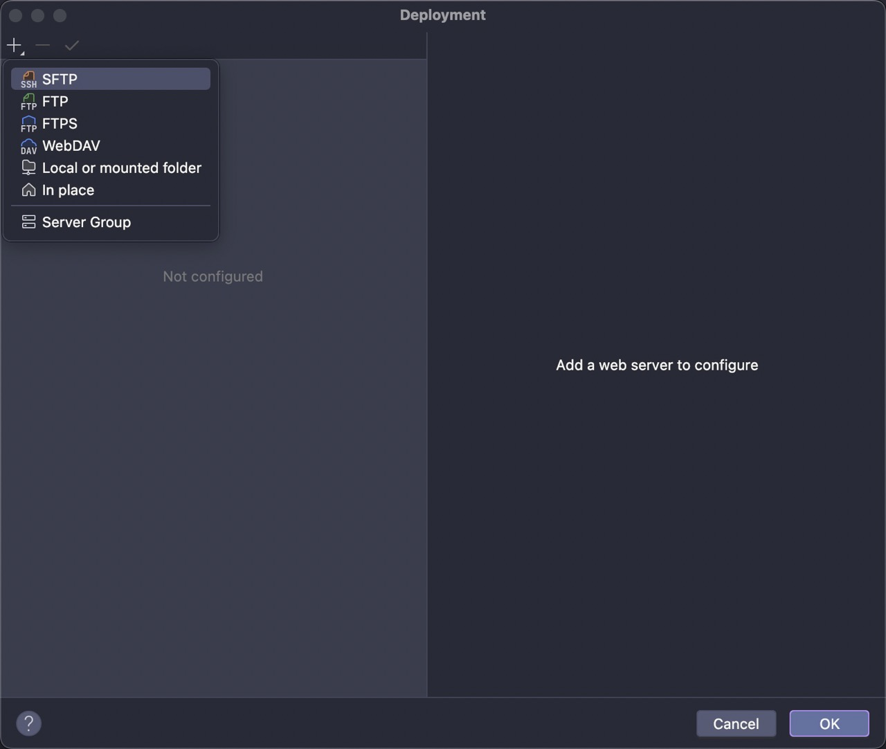

2. 在 `Connection-->SSH configuration` 中添加服务器IP和密码

    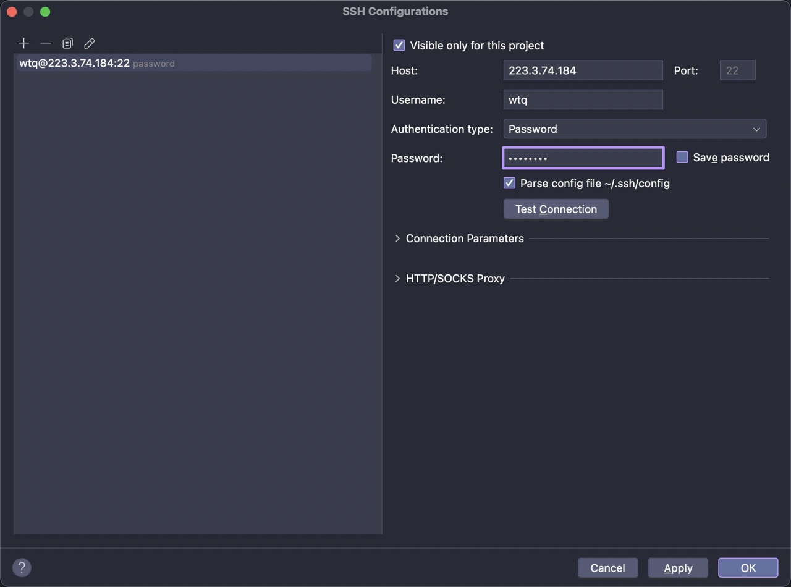

3. 在 `Conection-->Root path` 设置根目录（点击Autodetect）

    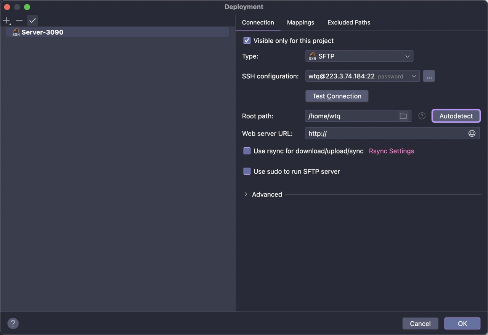

4. 在 `Mappings-->Deployment path` 中选择服务器上对应的项目文件夹

    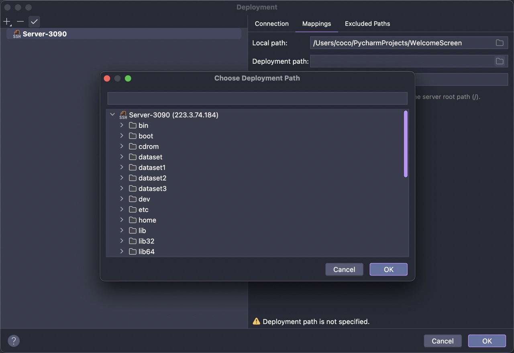

5. 打开 `Tools-->Deployment-->Automatic Upload` 自动上传功能

### 远程Debug

1. 在 `Settings-->Python-->Interpreter-->Add Interpreter` 选择On SSH，然后选择需要的SSH连接，点击 ==Move==

    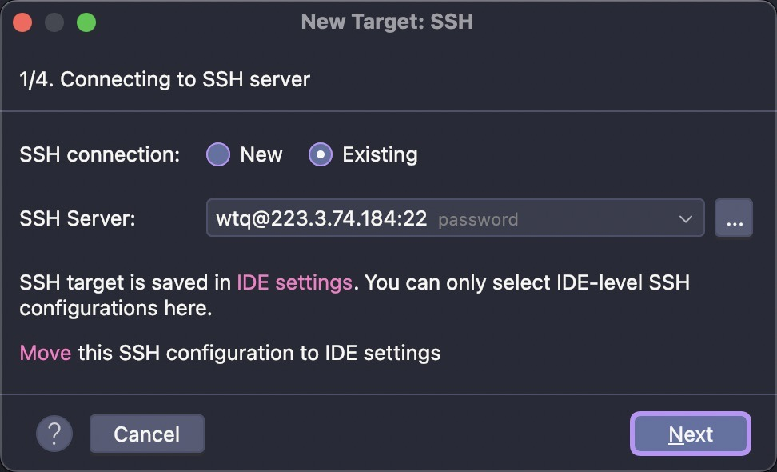

2. 选择服务器上的conda路径以及虚拟环境，使用 `realpath $(conda info --base)/bin/conda` 查看

    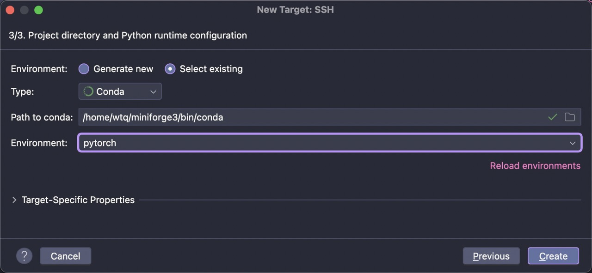

3. 在 `Target-Specific Properties-->Sync folders` 设置服务器上对应的项目文件夹 

    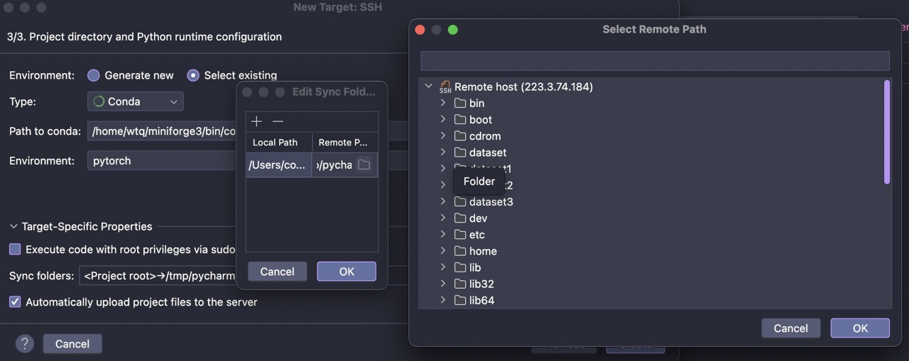


